# PulseLite
## Final build and verification report

**20 November 2026 · Asia/Kolkata**  
Built in one isolated repository: `pulselite`, inside the existing Designer projects workspace.

> **Outcome:** the application is built, published, and verified locally and on its public deployment. The final named test suites pass. Earlier failures remain permanently recorded. The free hosting is a personal, non-commercial demonstrator—not a commercial-service launch or an uptime guarantee.

## 1. Project overview

PulseLite is an original website analytics product with its own name, visual design, SVG identity and implementation. Its interface uses a restrained teal/ink palette, light and dark themes, responsive layouts, semantic forms and tables, and a focused analytics dashboard. No other project's code, logo or assets were copied or modified.

### Published links

| Destination | Link |
|---|---|
| Home and dashboard | https://pulselite-web.vercel.app |
| Labelled synthetic demo | https://pulselite-web.vercel.app/demo |
| Privacy explanation | https://pulselite-web.vercel.app/privacy |
| Real database health endpoint | https://pulselite-backend.vercel.app/health |
| Sample website | https://pulselite-demo.vercel.app |
| Public GitHub repository | https://github.com/DIVYAPRIYADHARSHINI-GIT/pulselite |

GitHub is under **DIVYAPRIYADHARSHINI-GIT**. The repository uses `main`, with git identity set locally to Divya Priyadharshini and the requested email. Vercel uses the **Divya / divya-6411 Hobby** workspace. The new database is **pulselite-postgres**, provisioned on Neon **Free**, region iad1. No paid upgrade or payment details were used.

### Architecture and completed scope

`ARCHITECTURE.md` was written before implementation. The repository contains separate `frontend` and `backend` applications, plus `tracker` and `demo-site`. The frontend is Vite, React and TypeScript. The backend is Python/FastAPI, SQLAlchemy and Alembic, with PostgreSQL in hosting and SQLite locally. Owner API calls use a first-party frontend proxy to the separate backend project, avoiding reliance on third-party authentication cookies.

Completed features include sign-up, sign-in, sign-out, owner-scoped websites, copyable installation snippets, Do Not Track settings, today/7-day/30-day/custom UTC ranges, page and dimension filters, previous-period comparisons, a time-series chart with a table alternative, top pages/referrers/sources, device/browser/country breakdowns, live five-minute activity, and aggregated CSV export. Loading, error recovery, empty states, keyboard navigation, light/dark and phone layouts are implemented.

The original Form & Field sample website can send real pageviews when connected to an owner's public site key. Separately, the seed script creates **5,719 synthetic events over 30 UTC days** in an explicitly labelled demo. Synthetic and real test events are not mixed into the same site.

The tracker is **1,104 uncompressed bytes**, below 3,000 bytes. It uses no cookies or local/session storage. Actual Chrome network headers verified that its event POST sends neither Cookie nor Referer. It sends pathname without query/fragment, referrer hostname, coarse screen category and a pageview/DNT signal. It consumes and discards the small response body to complete the network request.

The backend stores a daily, site-specific HMAC rather than IP or full user-agent inputs. A fresh random salt is generated for each UTC day; older salts are removed on rotation/cleanup. Browser family is reduced to an allowlisted category. Country comes only from the trusted hosting header, otherwise it is unknown; no city or location database is used. Owner emails and authentication data are explicitly distinguished from visitor analytics in the privacy page.

Security work includes Argon2id passwords, hashed session tokens, production Secure/HTTP-only/SameSite=Lax cookies, ownership checks, strict input schemas, body caps, exact origin checks, a basic crawler filter, database-backed rate limiting, SQL aggregation, query indexes, and a retention cleanup command. All request-body validation errors are generic rather than echoing passwords or payloads.

## 2. Testing and evidence

### Final suite results

These are real named test/check counts, not estimates. Repeated reruns are not added as new unique tests. Axe audits are nested inside browser checks and are not added again to the named-check total.

| Suite | Passed | Failed | What was executed |
|---|---:|---:|---|
| Backend, SQLite | 53 | 0 | Privacy, daily salt rotation, auth, sessions, ownership, bot filter, rate limits, origins, SQL statistics, dates, retention and strict inputs |
| Backend, hosted PostgreSQL mode | 53 | 0 | Same suite inside Vercel; 48 API/database cases use isolated PostgreSQL schemas, five pure/in-memory cases remain independent |
| Frontend unit and component tests | 25 | 0 | UTC ranges, comparison, safe CSV, snippets, country labels, loading/errors, chart table, zero data and decorative icon semantics |
| Tracker runtime tests | 12 | 0 | Size, payload, query/referrer stripping, DNT, coarse devices, cookie/storage traps, SPA navigation and network failure |
| Local Chrome journey | 20 | 0 | Complete owner journey with actual demo-site collector requests, export, filters, themes and mobile |
| Final public Chrome journey | 20 | 0 | Same full journey on the final hosted UI, including Secure cookie assertion and actual PostgreSQL-backed counts |
| Extended Chrome checks | 5 | 0 | Mobile dark sign-up, loading, simulated service-error recovery, custom range/table keyboard use, 768/1024 px overflow |
| Public health and demo SQL checks | 2 | 0 | Real `SELECT 1` and real seeded PostgreSQL aggregation |

The latest successful local journey included **12 axe page audits**, the final live journey included **12**, and the extra mobile sign-up check included **one**. These **25 latest-run audits had no violations** under the configured WCAG 2 A/AA and 2.1 AA rule tags. They are automated audits, not a complete accessibility certification. The final full local and live journeys recorded **zero unexpected browser console errors and zero failed network requests**.

The backend privacy test sends a distinctive synthetic IP and raw user agent, then inspects every database table and confirms neither input was written. It also verifies path-query stripping, referrer-host reduction, and the absence of visitor IP/UA/city/name/email columns. The test runs in the SQLite and hosted PostgreSQL-mode suites.

The hosted PostgreSQL suite ran **inside Vercel's build environment**, so database credentials were never downloaded locally. Each relational test creates a random `pulselite_test_…` schema and drops it in fixture teardown. Production owner/event tables are not test fixtures. Final hosted run: **53 passed in 24.74 seconds**, with **437 repeated deprecation warnings**, chiefly Python 3.12 `datetime.utcnow()` warnings. The local Python 3.11 run has one third-party TestClient deprecation warning. These compatibility warnings remain known maintenance work, not hidden failures.

TypeScript/Vite production builds pass. Alembic upgrade and schema-drift checks passed locally; production migrations and the public health query succeeded. The final npm audit reports zero vulnerabilities, and the patched Python environment audit reports no known vulnerabilities. A staged-file scan found no prohibited credential/database/cache paths, no configured secret patterns, and no individual staged file over the **5 MiB** threshold before publishing. Pattern scanning is not a mathematical guarantee against every possible secret format.

### Earlier failures and reruns

The original evidence was never deleted or renamed. [The evidence index](reports/EVIDENCE_INDEX.md) links every retained command transcript, browser report, bug artifact and screenshot. Dependency/build failures are described in section 3. The complete browser attempt history is summarized here so successful reruns do not conceal earlier outcomes.

| Browser attempt, IST | Passed | Failed | Result |
|---|---:|---:|---|
| Local 10:04 | 0 | 1 | Home text contrast failure |
| Local 10:05 | 2 | 1 | Inline link lacked non-color distinction |
| Local 10:47 | 7 | 1 | Stalled body inspection; manually stopped; child recorded target closure |
| Local 10:49 | 6 | 1 | Empty-state assertion ran before rendering completed |
| Local 10:51 | 7 | 1 | Second stalled body inspection; manually stopped |
| Local 10:53 | 7 | 1 | Watchdog exposed the pending collector check |
| Local 10:54 | 7 | 1 | Instrumentation narrowed the wait to response body |
| Local 10:56 | 7 | 1 | Runtime restart did not resolve that wait |
| Local 10:57 | 7 | 1 | Network-idle wait exposed incomplete response consumption |
| Local 10:58 | 8 | 1 | Metric assertion read stale pre-refresh content |
| Local 10:59 | 11 | 1 | Rapid date change restored a cleared page filter |
| Local 11:01 | 20 | 0 | Full journey passed after fixes |
| Local 11:03 | 20 | 0 | Final local capture run passed |
| Live 11:03 | 20 | 0 | First complete public journey passed |
| Live 11:07 | 12 | 1 | Site-list assertion ran while its loading state was visible |
| Live 11:08 | 20 | 0 | Public journey passed with explicit readiness waits |
| Live 11:18 | 20 | 0 | Final release retest passed after URL-preset synchronization fix |

The first backend attempt had **4 passed and 45 setup errors** because the custom pytest temp parent was absent; the next run passed all 49 then-existing tests. Four regressions expanded the suite to 53. The first hosted PostgreSQL attempt had **5 passed, 3 failed and 45 setup errors**; direct IPv4 connections resolved the test connection problem, and the retry passed 53. The extended browser fixture first recorded **0 passed/1 failed** because axe requires an explicit browser context; its corrected run passed all five. The frontend component expansion initially passed 25 but emitted a React SVG-title warning; a clean rerun passed 25 without that warning.

### Real browser screenshots

The following images are actual captures, not mockups. The `live-` prefix identifies public-deployment captures. Full-height and viewport variants are both retained where useful.

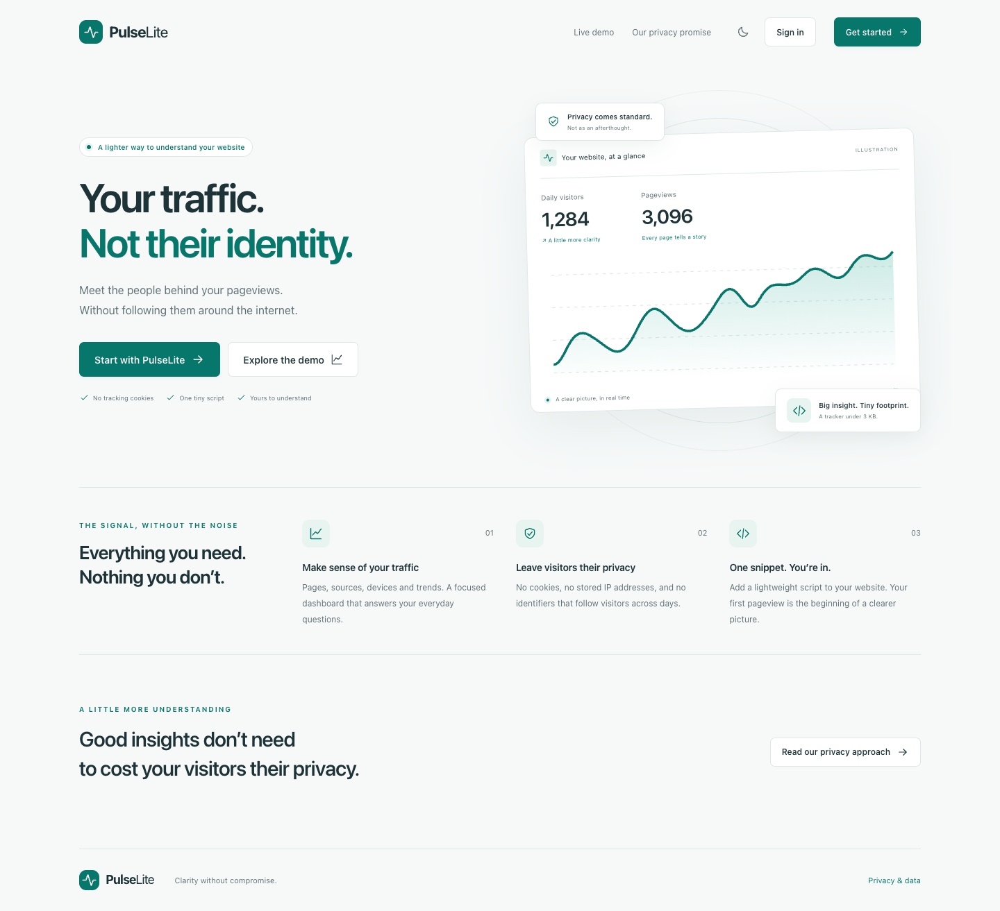

*Figure 1. Public home page, original PulseLite identity and explicitly labelled illustrative preview.*

*Figure 2. Public sign-up page captured before credentials were entered; no password is shown or retained.*

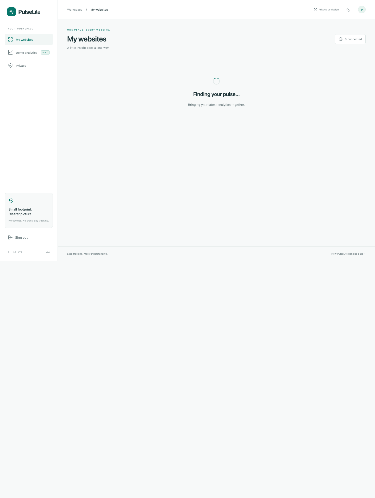

*Figure 3. Signed-in public sites page with the clearly named CHROME TEST website.*

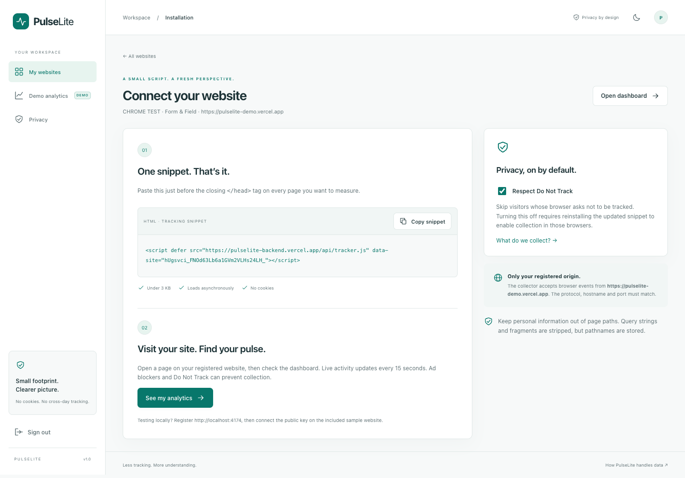

*Figure 4. Actual install screen with public site key, copy control and default Do Not Track setting.*

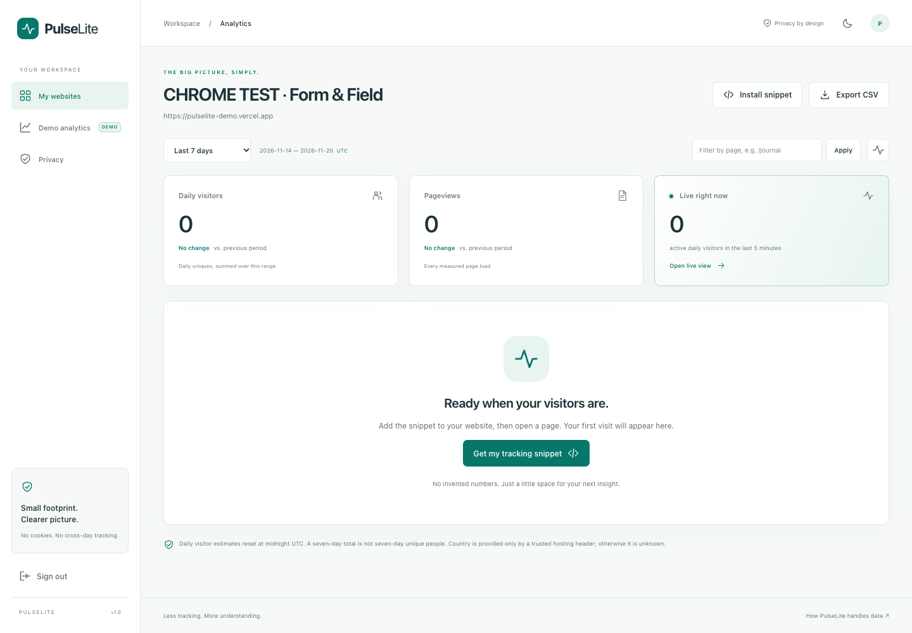

*Figure 5. Unvisited site's honest empty state, before the tracker generated any data.*

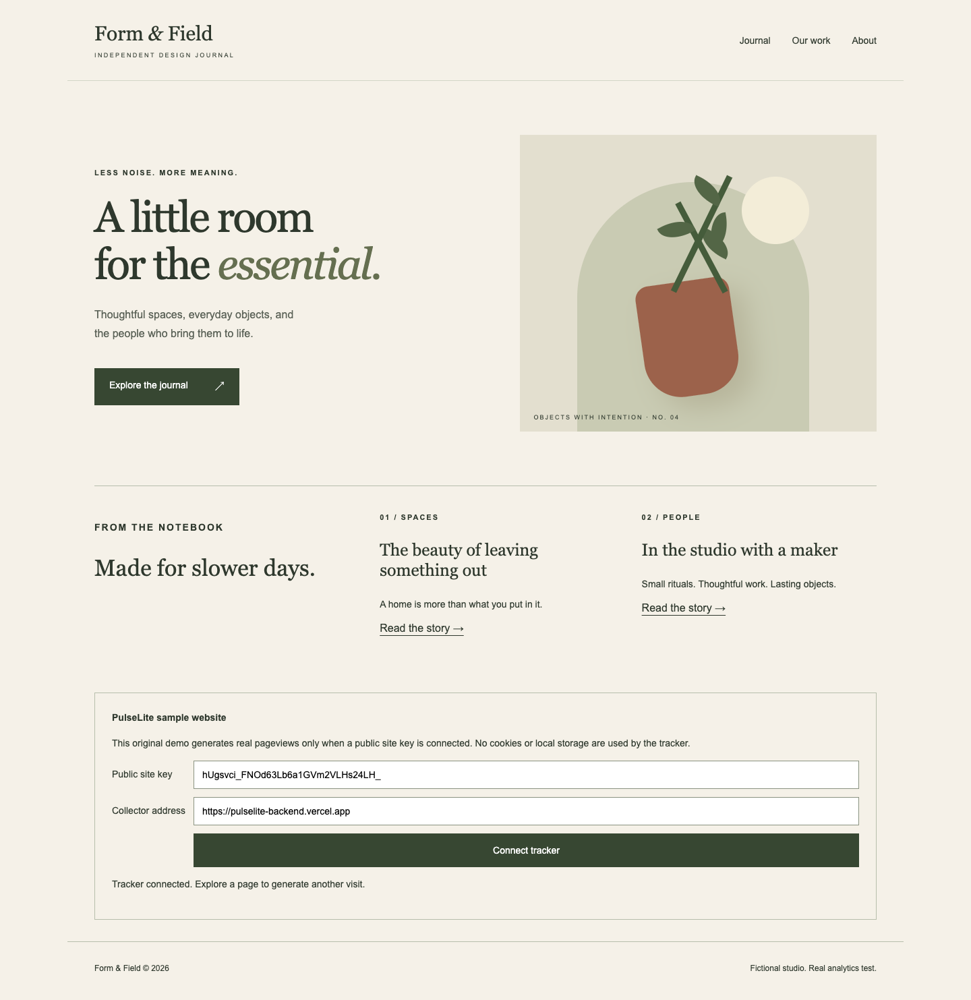

*Figure 6. The separately deployed Form & Field sample website connected to the real collector. The key is public, not an authentication secret.*

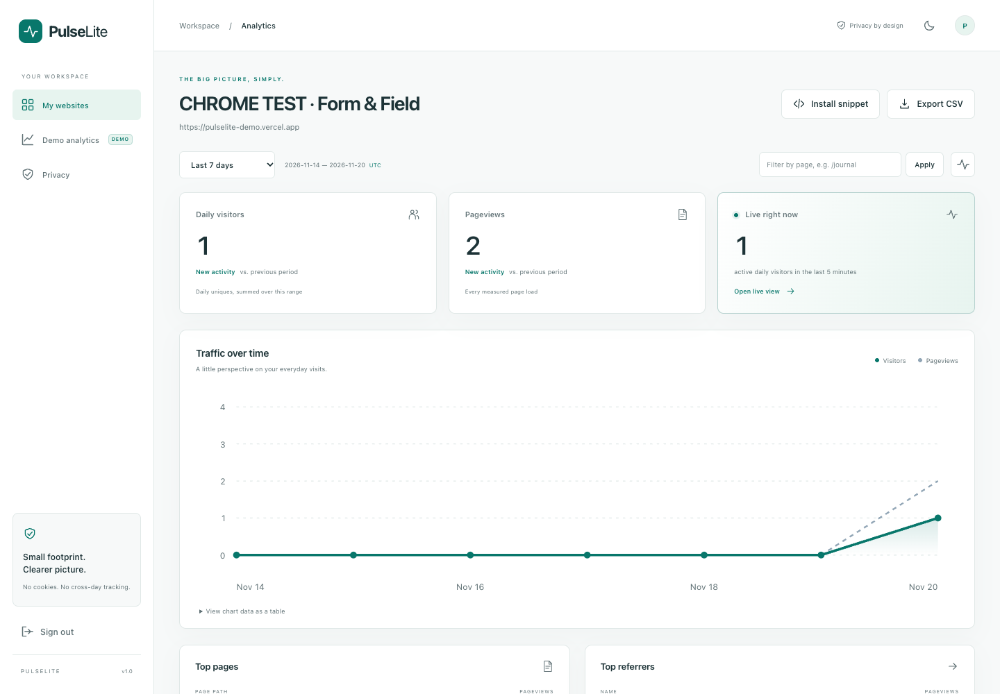

*Figure 7. Two real sample-page views persisted through the collector and appeared as one approximate daily visitor in PostgreSQL-backed statistics.*

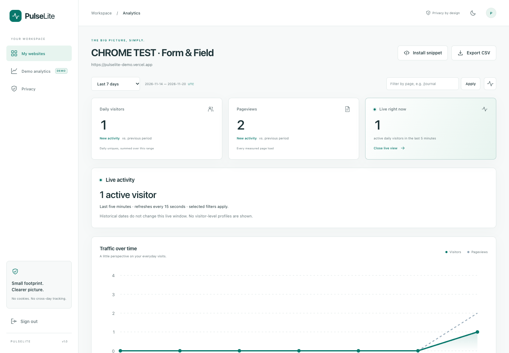

*Figure 8. Public live view shows the measured visitor in the last five minutes. It exposes no visitor profile.*

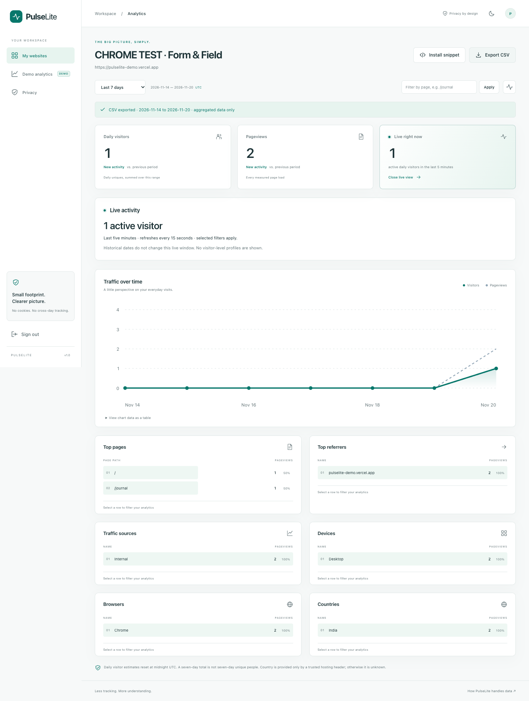

*Figure 9. Export confirmation after an actual CSV download. The test read the file and verified aggregate columns and the visited page path.*

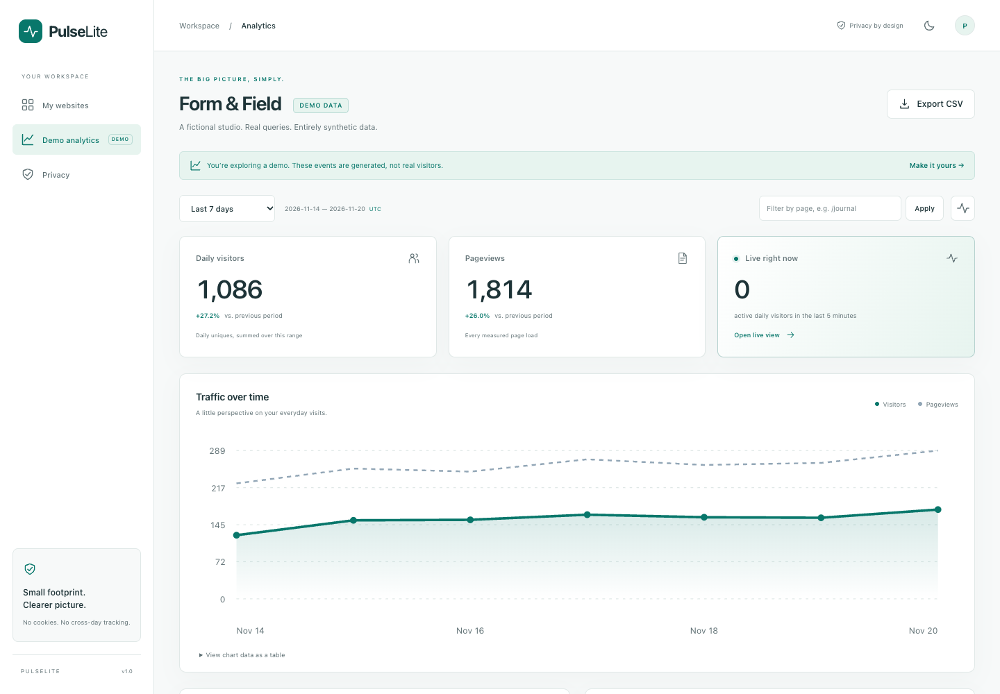

*Figure 10. Light-theme dashboard displaying the clearly labelled synthetic demo. Full-height captures include all six breakdown panels.*

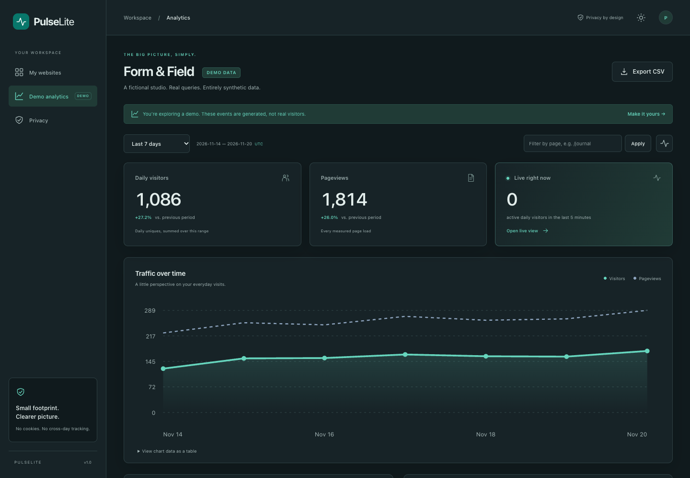

*Figure 11. Dark theme after a hard reload, proving preference persistence. The same underlying demo data is used.*

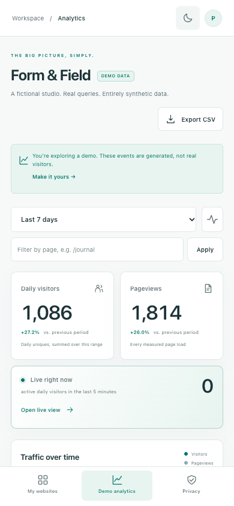

*Figure 12. Actual 390 × 844 Chrome viewport, with responsive controls and bottom navigation. Dark-phone captures are also retained.*

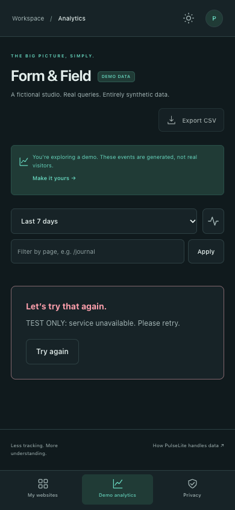

*Figure 13. Local error-recovery test with a deliberately injected, labelled HTTP 503 response. This is a test fixture, not a production outage; Retry then recovered successfully.*

### Test-data inventory

Local cleanup deleted **11 explicitly labelled Chrome test accounts, 11 test sites and 16 events**, retaining only the intended synthetic demo. The exact inventory is in [local-test-cleanup.json](reports/local-test-cleanup.json). Temporary pytest databases/browser files are ignored generated test artifacts, not production databases.

These **four hosted test accounts/sites remain intentionally listed**, satisfying the requirement that no production test data be left unnoticed. All use randomly generated in-memory passwords that were not printed or saved. Each recorded two real test pageviews. They are not suggested login accounts for the user.

| Hosted test account | Site ID | Site name |
|---|---:|---|
| chrome-test-1795152839693@pulselite.test | 2 | CHROME TEST · Form & Field |
| chrome-test-1795153041300@pulselite.test | 3 | CHROME TEST · Form & Field |
| chrome-test-1795153125659@pulselite.test | 4 | CHROME TEST · Form & Field |
| chrome-test-1795153697541@pulselite.test | 5 | CHROME TEST · Form & Field |

The intentionally retained synthetic owner is `demo-owner@pulselite.test`, with a random undisclosed password and a public read-only demo site. No shared demo login or authentication bypass is provided. PostgreSQL unit/API test schemas are disposable and dropped in teardown. No unrelated production database was accessed or changed.

## 3. Bugs and issues

### Environment, dependency and build findings

**B01 — Unexpected Python base interpreter.** The initial runtime reported Python 3.11, but a generic venv command created Python 3.15. The pinned PostgreSQL wheel did not support it. Recreating only PulseLite's virtualenv with the verified 3.11 executable and `--copies` fixed installation. [Original diagnostic](bugs/20261120-095657-865260-stage1-install-FAILURE.txt).

**B02 — Missing pytest scratch parent.** The first backend suite could not create its scoped base-temp directory, causing 45 setup errors rather than product failures. Creating `tests/.tmp` fixed the fixture setup. [Original diagnostic](bugs/20261120-095813-621125-stage1-backend-tests-FAILURE.txt).

**B03 — Dependency advisories.** npm reported one Playwright high-severity advisory and later three frontend dev-tool advisories. Python audit reported 19 entries across four packages, including duplicate advisory identifiers. The affected packages were upgraded; final audits are clear. These were detected known-version risks, not observed exploits. [Playwright audit](bugs/20261120-095830-832735-dependency-audit-FAILURE.txt), [frontend audit](bugs/20261120-100229-904324-frontend-audit-FAILURE.txt), [Python audit](bugs/20261120-100509-553364-backend-audit-FAILURE.txt).

**B04 — Invalid empty CSS import.** Vite/PostCSS treated an unnecessary `data:text/css,` import as a file and failed with ENOENT. Removing the import restored the build. [Original build transcript](bugs/20261120-100232-505133-stage3-build-FAILURE.txt).

### Interface and browser findings

**B05 — Home-page contrast.** Axe measured the small feature numbers at **2.46:1**, below 4.5:1. The light-theme subtle text token was darkened; subsequent audits passed. [Axe diagnostic](bugs/2026-11-20T04-34-18-019Z-browser-diagnostic.json).

*Bug evidence B05. The original failed home capture is retained; the JSON records the exact affected elements and measured ratio.*

**B06 — Inline link used color alone.** The sign-up privacy link had insufficient distinction from surrounding text. Inline links now have an underline, and the sign-up audit passes. [Original diagnostic](bugs/2026-11-20T04-35-03-388Z-browser-diagnostic.json).

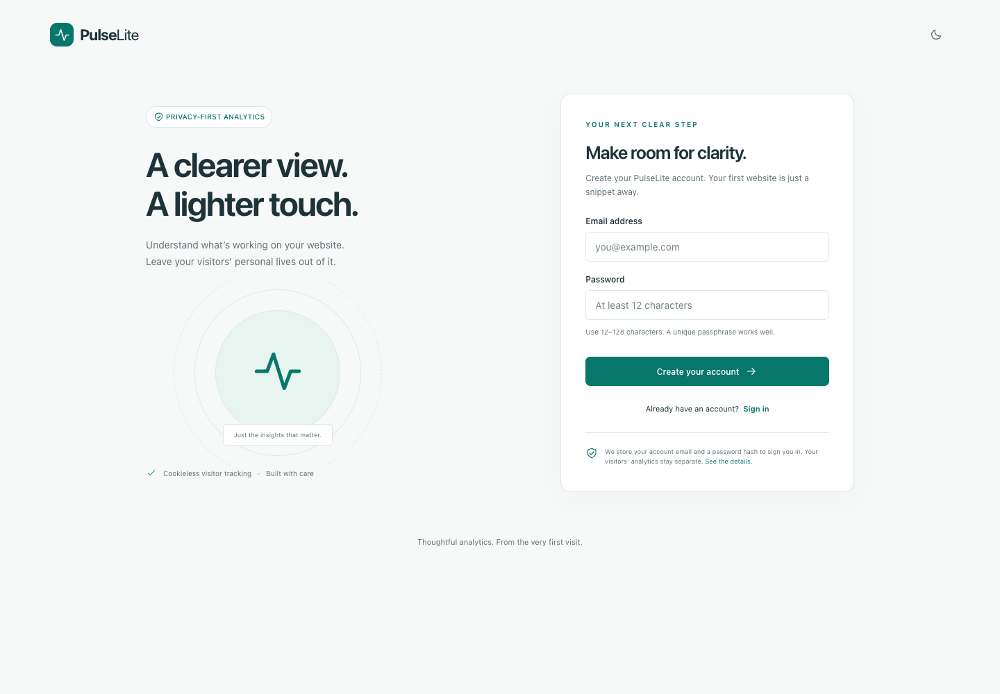

*Bug evidence B06. The original sign-up capture accompanies the axe rule failure; it contains no entered password.*

**B07 — Direct-referrer filter removed itself.** Source review found that clicking Direct mapped the display label to an empty string, which the UI treated as clearing the filter. An explicit Direct token now maps to an empty referrer in SQL, with a backend regression and Chrome verification. [Source-review record](bugs/006-direct-referrer-source-review.txt).

**B08 — Collector response completion and test stalls.** Several tests stopped while inspecting a keepalive response or waiting for network idle. Progress markers isolated the body wait; a separate HTTP client received `202 {"accepted":true}`. The initial assumption that this was only DevTools instrumentation was incomplete. Consuming/discarding response text in the tracker resolved the observed network completion. Browser acceptance is verified through actual SQL-backed dashboard counts, not merely HTTP 202, since ignored bots also get 202. [Diagnosis](bugs/020-keepalive-body-diagnosis.txt), [first interrupted run](bugs/010-chrome-harness-stall.txt), [second interrupted run](bugs/016-second-browser-stall.txt), and all watchdog transcripts remain in the evidence index.

**B09 — Premature browser assertions.** Empty-state, metric and later live site-list assertions ran before React's asynchronous data rendering completed. Saved screenshots showed either the correct final values or the explicit loading state. Assertions now wait for the expected semantic element/value, instead of assuming a cached network-idle state proves readiness. This was a test-harness timing defect, not lost data. [Empty-state record](bugs/2026-11-20T05-19-45-053Z-7-failure.txt), [metric record](bugs/2026-11-20T05-28-15-471Z-9-failure.txt), [live site-list record](bugs/2026-11-20T05-37-21-298Z-13-failure.txt).

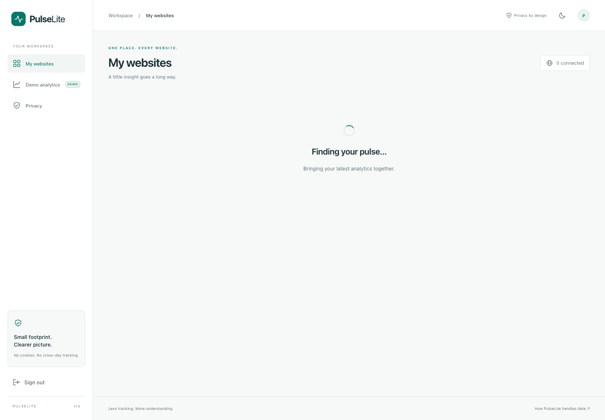

*Bug evidence B09. The failed test asserted “Owner site missing” while the application was visibly still loading. The final awaited assertion passes.*

**B10 — Cleared page filter returned after a rapid range change.** This was a real interaction bug: the date handler reused an older router search snapshot and restored the removed page filter. Mutation handlers now read the current URL search state. The same rapid clear/change sequence passes locally and live. [Original failed test](bugs/20261120-105912-291428-stage4-chrome-metric-waits-FAILURE.txt).

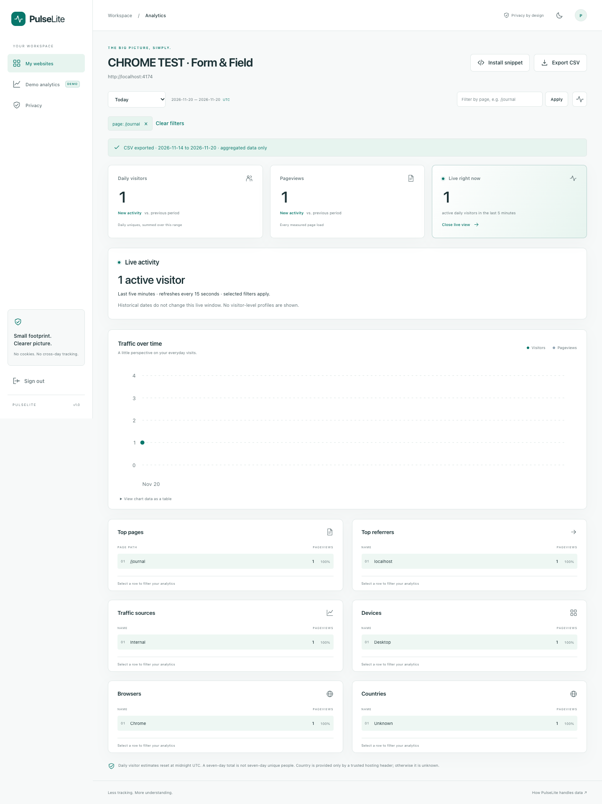

*Bug evidence B10. The page filter chip incorrectly remained after the fast clear/date interaction. The exact original screenshot is preserved.*

**B11 — React SVG-title warning.** Component tests passed but server rendering warned about a multi-child SVG `<title>`. Each title now uses one template-string child. The clean 25-test rerun has no such warning. [Warning record](bugs/025-react-svg-title-warning.txt).

**B12 — Extended axe fixture setup.** The extra suite used Playwright's convenience `browser.newPage()`, but axe required an explicit `browser.newContext()`. The corrected fixture passed all five checks. [Original tool diagnostic](bugs/2026-11-20T05-34-05-050Z-extra-1.txt).

### Tool and deployment findings

**B13 — Screenshot inspection path typo.** I guessed a millisecond suffix instead of listing the actual artifact path. Designer correctly returned ENOENT. A scoped glob found the exact file; no evidence was renamed or deleted. This was my path-selection error. [Diagnostic](bugs/013-screenshot-inspection-path-error.txt).

**B14 — Vercel automatically created a credential file.** Despite no explicit env-pull request, `vercel link` created `.env.local`. I never opened it; it was immediately deleted unread, kept ignored, and reported to the user. Later projects used explicit non-secret IDs rather than the link command. [Record](bugs/011-vercel-automatic-env-file.txt).

**B15 — Configuration stall and first health failure.** `vercel env add` saved the first variable but did not return. I deployed before the remaining settings had completed; the first `/health` returned HTTP 500. This was a release-order mistake, not a successful health check. Configuring the remaining values and redeploying fixed it. [Original diagnostic](bugs/014-production-config-and-cli-stall.txt).

**B16 — Bulk environment JSON rejected.** Sending an array through the observed Vercel API command returned HTTP 400 “Invalid JSON”. Applying one JSON object at a time through stdin succeeded without reading or printing any secrets. [Original transcript](bugs/20261120-105221-370032-stage5-backend-config-FAILURE.txt).

**B17 — First hosted PostgreSQL suite could not connect correctly.** The isolated-schema test URL used startup options with the pooled endpoint; failed connection attempts ultimately reported unreachable IPv6. Direct Neon connections with resolved IPv4, while retaining the original TLS hostname, fixed the suite. The failing deployment was not promoted; the prior healthy backend stayed available. The retry passed all 53. [Original hosted failure](bugs/20261120-105920-214356-stage5-postgres-build-FAILURE.txt), [successful retry](reports/20261120-110109-079912-stage5-postgres-direct-retry.txt).

**B18 — Report pagination.** The first PDF placed a redundant delivery paragraph alone on its last page. That initial PDF is preserved, the redundant paragraph was removed, and the concluding limits section was given its own page. [Visual-review record](bugs/026-report-pagination-review.txt) and [follow-up](bugs/027-report-pagination-followup.txt).

**B19 — Date preset did not hydrate from the URL.** Final source review found a hardcoded Last 7 days initial selection even when reloading a different date range. The preset and page input now synchronize with URL state; the existing custom-range browser check also reloads a today-range URL and verifies its preset and one-row table. [Source-review record](bugs/028-date-preset-source-review.txt).

No known functional failure remains in the final tested journeys. Remaining warnings and product limits are described below rather than presented as fixed.

## 4. Advantages of Designer observed in this build

Designer let me create the isolated folder and architecture document directly, then edit only named project files. Expected-version checks provided an explicit safeguard for source mutations. I did not need to open the other projects that were already visible in the editor.

The permission questions provided clear, separate approval gates. Local SQLite/tool use, GitHub, Vercel and hosted database/environment changes were each approved before their corresponding external work. This made the boundaries visible rather than relying on an informal assumption.

Background tasks let independent installs, tests and deployment operations run while I worked on other files. Their output and exit status made it possible to distinguish a successful build from a failed health check. Live web research supplied official hosting/runtime/plan references rather than guessed free-tier details.

The image observation tool let me inspect real browser captures, including the exact failed states, dark dashboard and phone viewport. This helped distinguish genuine layout/interaction bugs from premature test assertions. Source, evidence, README, deployment guide and final report could remain together in one workspace.

## 5. Disadvantages and limits of Designer observed

The web-testing workflow used custom Playwright scripts and a command wrapper rather than a single automatically assembled test/evidence report. I had to implement the check counters, append-only transcripts, screenshot names and final evidence index myself.

Very long terminal results were truncated in tool excerpts and required additional reads. My first wrapper also buffered output until exit, which hid progress during browser stalls; that was a flaw in my wrapper, not proof that Designer cannot stream output. Switching to streamed output and operation markers made diagnosis much easier.

Long full-page phone screenshots became very small in the image overview. Separate viewport captures were needed for readable inspection. The image tool also cannot infer a mistyped timestamp; my guessed path failed until I enumerated the artifact.

Designer did not make external CLI behavior predictable. The Vercel link command unexpectedly created a credential file, and its env command stalled. Those are observed Vercel/tooling issues, not attributed to Designer itself. They still required explicit recovery and careful evidence handling inside the workflow.

## 6. Scope for future Designer improvements

A first-class web verification view could combine named check counts, request diagnostics, console messages, axe findings and screenshots into one timeline. It should distinguish a product failure, a test-fixture error, an intentionally simulated failure and an interrupted run.

A persistent permission/resource ledger would help show exactly which account, project, database and variable names have been approved. A safety layer could warn before a third-party CLI automatically downloads credentials, without opening the resulting file.

Artifact tools could offer readable viewport crops, side-by-side light/dark comparison and automatic links from failed checks to the correct screenshots. This would reduce manual timestamp mistakes and the need to maintain an evidence-index script.

Reusable recipes for unbuffered task output, semantic browser waits, secure deployment variables and Markdown-to-PDF evidence reports would reduce repetitive setup. These are improvement opportunities drawn from this session, not claims that existing tools are generally incapable of the work.

## 7. Unverified areas and PulseLite's known limits

**Hosting scope.** The live app works as a small personal, non-commercial demonstration. Vercel Hobby's terms do not permit using it as a commercial analytics service. No upgrade was made. Cold-start behavior is possible in both Python and Neon; prolonged availability, billing-quota exhaustion and sustained load were not tested. The documented default collector limit is 120 requests/minute/site.

**Privacy scope.** Daily HMACs are pseudonymous within a day, not a guarantee of legal anonymity. Totals across days are daily identities, not cross-day unique people. Shared IP/UA can merge visitors, and changed IP/UA can split one visitor. Sensitive information inside a pathname is not automatically recognizable. Owners must avoid installing the tracker on sensitive routes. Hosting network/access logs remain outside the application's control.

**Operations.** The cleanup command works and is tested, but an automatic production retention schedule has not been provisioned. A `RETENTION_DAYS` value alone does not delete old data. The operator must schedule authorized maintenance. PostgreSQL test fixtures drop their own schemas; four hosted Chrome test accounts/sites are intentionally retained and explicitly listed above.

**Security/product depth.** Domain ownership is not verified; Origin checks and public keys cannot stop forged non-browser clients. Bot detection is basic. There is no password reset, email verification, team-role system, billing, account-deletion UI, consent-management integration, long-term rollups, or formal penetration test. No legal compliance certification is claimed.

**Testing scope.** Actual Chrome was used, including 390 px phone emulation and 768/1024 px tablet-width checks. Physical phones, Safari, Firefox, screen-reader assistive-technology sessions, all ad-blocker combinations and multi-region behavior were not tested. Automated axe checks do not replace a full accessibility review. A regular browser UA was deliberately supplied for the visitor-test context so the known headless-bot filter would not intentionally suppress the test visit.

**Maintenance.** Python 3.12 deprecation warnings and a third-party TestClient warning remain; replacing naive UTC clock calls with a centralized compatible clock is future maintenance. GitHub `main` is published, but automatic GitHub-to-Vercel deployment linkage was not configured or claimed; the observed deployments used the approved CLI projects.

